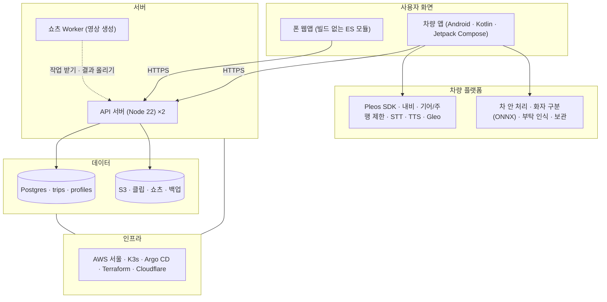
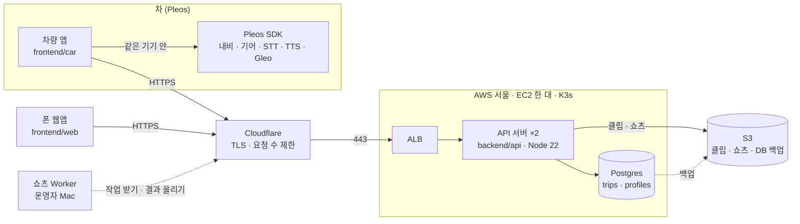
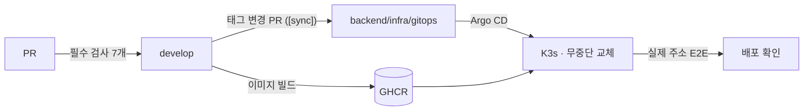

<p align="center"></p>

# 가치타

**가족이 차 안에서 나눈 대화를 차가 받아 적어, 아이의 부탁은 내비 경유지로, 장소별 할 일은 도착했을 때 알려 주고, 여행 뒤에는 웃긴 순간을 쇼츠로 남기는 Pleos 차량 앱입니다.** PITCREW 팀의 현대자동차그룹 Pleos 해커톤 제출작입니다.

## 제출 안내

| 항목 | 내용 |
|---|---|
| 앱 이름 | **가치타** (PITCREW) |
| 한 줄 소개 | 차 안 가족 대화를 받아 적어 부탁은 경유지와 도착 브리핑으로, 즐거운 순간은 쇼츠로 남기는 차량 앱 |
| APK 파일 위치 | [`apk/pitcrew_gachita_release.apk`](apk/pitcrew_gachita_release.apk) (서명한 release, SHA-256 `defa488c1d676d7ffab981e1e0c2b69b30fdef301360a870541aaf175e4d4b27`) |
| GitHub Release | [v1.0.0](https://github.com/team-pitcrew/gachita/releases/tag/v1.0.0) (같은 APK를 첨부) |
| 서비스 주소 | https://gachita.mangowhois.ai (API 서버와 폰 웹앱) |

### 실행 방법

1. Pleos Connect Emulator 2.1.0을 켭니다.
2. APK를 설치합니다.
   ```bash
   adb install -r -d -g apk/pitcrew_gachita_release.apk
   ```
3. 앱 목록에서 **가치타**를 엽니다. 서버 주소는 운영 서버(`https://gachita.mangowhois.ai`)가 기본값이라 따로 넣지 않습니다.
4. 계정을 만들고 기록에 동의한 뒤, 프로필과 목소리(15초)를 등록합니다.
5. 가족을 추가하고 좌석을 정한 다음 **이 그룹과 출발**을 누르면 기록이 시작됩니다. 동승자는 초대 링크나 QR로 폰 웹앱에서 참여합니다.
6. 주차(P) 상태에서 **콘텐츠 기록** 탭을 열면 추천 장면을 골라 쇼츠를 만들고 다시 볼 수 있습니다.

### 테스트 환경과 필요한 설정

| 항목 | 값 |
|---|---|
| 에뮬레이터 | Pleos Connect Emulator **2.1.0** |
| OS · 아키텍처 | Android 14 (API 34) · arm64 |
| 화면 규격 | **2560 × 1440 px**, 160 dpi (앱 전체 창과 내비 옆 반쪽 창 모두 지원) |
| 네트워크 | 인터넷 연결 필요(운영 서버와 통신) |
| 권한 | 마이크(녹음) — 설치할 때 `-g`로 주거나 첫 실행에서 허용 |
| 차량 상태 | 기어 P에서 가족·좌석·콘텐츠 기록, 기어 D(주행 제한)에서 주행 화면. Virtual Console로 바꿉니다 |
| 확인 범위 | 에뮬레이터에서 확인했습니다. 실차에서는 확인하지 않았습니다 |

### 대표 구조도



자세한 구조와 근거는 아래 [구조](#구조)와 [구조와 스택](docs/architecture.md)에 있습니다.

| | |
|---|---|
| 서비스 | **https://gachita.mangowhois.ai** (서버와 폰 웹앱, 2026-11-13부터 AWS) |
| 차량 앱 | [`apk/pitcrew_gachita_release.apk`](apk/pitcrew_gachita_release.apk) · [차량 앱 README](frontend/car/README.md) |
| 구조 | [구조와 스택](docs/architecture.md) · [결정 기록(ADR)](docs/adr) |
| 화면과 시연 | [화면 기준과 시연 35단계](docs/design-screens.md) · [시연 영상 계획](docs/demo-video.md) |

## 무엇을 하는가

- **받아 적기.** 차량 앱이 기록 동의를 받은 뒤 차량 마이크로 수음하고 Pleos STT(ON_DEVICE)로 받아 적습니다. 폰에서는 수음하지 않습니다.
- **부탁을 경유지로.** "화장실 가고 싶어"를 알아채 휴게소를 화면과 말로 제안하고, "응, 다음 휴게소 가자"로 순정 내비에 경유지를 넣습니다. 후보는 서버가 내비의 지금 위치·목적지와 한국도로공사 휴게소 자료로 고릅니다. 서버에 닿지 않으면 시연 경로의 고정 목록을 씁니다.
- **도착하면 할 일.** "마트에서 우유랑 간식 사자"를 모아 두었다가 그 장소에 주차하면 알립니다.
- **주행 중 화면.** Pleos 주행 제한 값에 맞춰 설정 화면과 목록을 가립니다.
- **Gleo와 마이크 나누기.** "글레오"라고 부르면 기록을 멈추고 마이크를 Gleo에 넘겼다가, 끝나면 다시 기록합니다.
- **여행 뒤.** 고른 장면으로 세로 쇼츠를 만들고, 콘텐츠 기록에서 다시 봅니다. 폰 웹앱은 계정·프로필, 가족·동승 그룹과 초대, 기록 동의, 대화 기록, 콘텐츠 기록을 맡습니다.

차량 앱의 동작은 Pleos Connect Emulator 2.1.0에서 확인했습니다. 실차에서는 확인하지 않았습니다. Gleo가 우리 함수를 음성으로 부르는 것은 Pleos 승인 전이라 확인하지 않았습니다.

## 구조

### 실행 경로

차와 폰은 같은 주소의 API 하나를 씁니다. 말한 사람을 가리는 계산은 차 안에서 하고([ADR-0023](docs/adr/0023-speaker-identification-on-device.md)), 서버는 저장과 동기화를 맡습니다.



| 상자 | 맡는 일 | 근거 |
|---|---|---|
| 차량 앱 | 수음과 받아쓰기, 말한 사람 가리기, 부탁 제안과 경유지, 도착 브리핑, 차 안 보관 | [차량 앱 README](frontend/car/README.md), [ADR-0008](docs/adr/0008-in-car-capture-and-sdk-stt.md) |
| 폰 웹앱 | 계정·프로필·목소리 등록, 그룹과 초대, 동의, 대화 기록, 콘텐츠 기록. 빌드 없는 ES 모듈 | [`frontend/web`](frontend/web) |
| API 서버 | 계정·프로필·그룹·여행·동의 저장, 차와 폰 동기화, 휴게소 추천, 클립과 쇼츠 보관 | [OpenAPI 명세](docs/api/openapi.yaml), [음성 처리 명세](docs/api/voice.md) |
| Postgres | CloudNativePG 클러스터 하나에 `trips`·`profiles` 두 DB | [ADR-0016](docs/adr/0016-slo-capacity-single-postgres.md) |
| 쇼츠 Worker | 서버 큐에서 작업을 받아 영상을 만들고 결과를 올립니다. API 파드는 밖으로 부르지 않습니다 | [ADR-0025](docs/adr/0025-shorts-generation-worker-codex-skill.md) |

### 배포 경로

`develop`에 병합된 서버·웹 변경은 이미지 태그를 바꾸는 PR 하나를 거쳐 클러스터에 나갑니다. 차량 앱은 APK로 따로 나갑니다.



AWS 자원은 [Terraform](backend/infra/terraform/README.md)으로, 클러스터에 올리는 것은 [Argo CD 선언](backend/infra/gitops/README.md)으로 둡니다. 절차는 [개발 규칙](docs/development.md)에 있습니다.

## 심사 기준별로 볼 곳

| 기준 | 무엇을 했나 | 근거와 확인 수준 |
|---|---|---|
| 차량특화성 | 차 마이크로 수음해 차 안에서 받아 적고, 말로 수락한 부탁을 순정 내비 경유지로 넣고, 기어 P에서 그 장소의 할 일을 알립니다. 주행 제한 값에 맞춰 화면을 가립니다 | [차량 앱 README](frontend/car/README.md), [E2E 실측](docs/emulator/e2e-flow.md). 에뮬레이터에서 확인, 실차는 아님 |
| 창의성 | 시키지 않은 대화에서 부탁과 할 일을 뽑습니다. 말한 자리의 캐릭터를 강조하고, 고른 장면을 세로 쇼츠로 만들어 다시 봅니다 | [차량 화면](frontend/spec/car.md), [도착 후 화면](frontend/spec/after-trip.md), [화면 기준](docs/design-screens.md). 에뮬레이터와 브라우저에서 확인. 쇼츠 서버 생성은 11/15부터 실서비스에서 켬([ADR-0025](docs/adr/0025-shorts-generation-worker-codex-skill.md)) |
| 기술 활용성 | Pleos SDK 넷(Vehicle, NaviHelper, SpeechToText, TextToSpeech)과 Gleo 함수 선언, 좌석 구역과 등록한 목소리로 말한 사람 가리기, 실서비스(Cloudflare → ALB → K3s, CloudNativePG, Argo CD) | [구조와 스택](docs/architecture.md), [ADR-0008](docs/adr/0008-in-car-capture-and-sdk-stt.md), [ADR-0019](docs/adr/0019-speaker-matching.md), [ADR-0023](docs/adr/0023-speaker-identification-on-device.md). SDK는 에뮬레이터, 서버는 실서비스에서 확인 |
| 사업성 | 첫 고객은 어린 자녀와 이동하는 부모입니다. 사람마다 기록이 프로필에 쌓이고, 여행 뒤에는 고른 장면이 남습니다. 서버는 한 대로 동시 접속 300까지 재었고 월 약 $99로 둡니다 | [ADR-0016](docs/adr/0016-slo-capacity-single-postgres.md)(실제 EC2에서 잼), [음성 처리 명세](docs/api/voice.md) |

## 폴더

| 폴더 | 내용 |
|---|---|
| [`frontend/car/`](frontend/car) | Pleos 차량 앱. Android · Kotlin · Compose |
| [`frontend/web/`](frontend/web) | 폰 웹앱. 서버가 같이 내보냅니다. 웹 시연은 `/demo` |
| [`frontend/spec/`](frontend/spec) | 화면 명세 |
| [`backend/api/`](backend/api) | API 서버. Node 22 표준 `http`, Postgres, 클립과 쇼츠는 S3 |
| [`backend/infra/`](backend/infra) | [Terraform](backend/infra/terraform/README.md)과 [Argo CD 선언](backend/infra/gitops/README.md) |
| [`docs/`](docs) | [개발 규칙](docs/development.md), [구조와 스택](docs/architecture.md), [디자인 시스템](docs/design.md), [작업 목록](docs/tasks.md), [결정 기록](docs/adr), [실측 보고](docs/research) |
| [`apk/`](apk) | 제출용 차량 앱 APK |

## 실행 방법

### 차량 앱(Pleos 에뮬레이터)

1. **에뮬레이터.** Pleos Connect Emulator 2.1.0을 **Cold boot**로 켭니다. Quick boot에서는 기어 같은 차량 값을 읽지 못합니다. 기어와 속도는 Virtual Console(`adb forward tcp:8088 tcp:8088` 뒤 `http://127.0.0.1:8088/`)에서 바꿉니다.
2. **설치.** 앱은 사용자 10에서 돕니다. 같은 패키지의 디버그 빌드를 깔았던 에뮬레이터라면 서명이 달라 먼저 지웁니다(`adb uninstall io.github.teampitcrew.gachita`).

```bash
adb install --user 10 -r -g apk/pitcrew_gachita_release.apk
```

```bash
adb shell am start --user 10 -n io.github.teampitcrew.gachita/.MainActivity
```

3. **서버.** release APK는 `https://gachita.mangowhois.ai`에 연결합니다. 인터넷 연결이 필요합니다. 디버그 빌드만 실행 인자 `--es server`로 주소를 바꿉니다.
4. **흐름.** 화면별 동작과 자동 시연 실행기(`frontend/car/demo.py`, 디버그 빌드용)는 [차량 앱 README](frontend/car/README.md)에, 시연 35단계는 [화면 기준](docs/design-screens.md)에 있습니다.

### 서버와 웹앱

```bash
make hooks
```

```bash
make run
```

```bash
make check
```

`make hooks`는 복제한 뒤 한 번 커밋 훅을 겁니다. `make run`은 로컬 Postgres 컨테이너와 함께 `http://localhost:8787`에서 API와 웹앱을 띄웁니다. `make check`는 CI와 같은 검사입니다. 브라우저에서 `http://localhost:8787/demo`를 열면 차 화면 시연과 폰 웹앱이 나란히 뜹니다.

## 확인한 환경과 범위

- **차량 앱.** Pleos Connect Emulator 2.1.0(Android 14, API 34, arm64), Mac mini M5 Pro. 실차에서는 확인하지 않았습니다. 화면 크기와 확인 범위는 [에뮬레이터 스펙](docs/emulator/README.md)에 있습니다.
- **웹앱.** macOS의 데스크톱 Chromium 계열 브라우저와 폰 폭(390×844) 창. 실제 휴대폰 확인은 [기기 확인](docs/device-acceptance.md)에 적습니다.
- **빌드.** 차량 앱은 JDK 21과 Android SDK 34(`cd frontend/car && ./gradlew assembleRelease`). 릴리스 서명 키는 저장소에 없습니다. 서버는 Node.js 22.1 이상과 Docker(로컬 Postgres 17).
- **주소.** 차량 앱의 평문 http는 `10.0.2.2`·`localhost`·`127.0.0.1`에만 열려 있고 그 밖은 https만 씁니다.
- **보관.** 여행과 기록은 시간이 지났다고 지우지 않습니다. 본인이 지우거나 동의를 철회하면 지웁니다([보관 규칙](backend/api/retention.md)). 여행 전체 음성만 다 올린 뒤 2일이 지나면 지웁니다([ADR-0024](docs/adr/0024-full-trip-audio-upload.md)).

## API

정식 명세는 [docs/api/openapi.yaml](docs/api/openapi.yaml)입니다. API 테스트가 명세와 서버의 경로가 같은지 봅니다. 음성에 닿는 경로의 인증과 보관 규칙은 [음성 처리 명세](docs/api/voice.md)에 있습니다.

- JSON을 주고받습니다. 오류는 `{ "error": "사람이 읽는 이유", "type": "invalid" }`처럼 오고, 클라이언트는 `type`으로 가릅니다.
- **자리:** `ROW_1_LEFT`(운전석), `ROW_1_RIGHT`, `ROW_2_LEFT`, `ROW_2_CENTER`, `ROW_2_RIGHT`. Pleos Vehicle SDK의 `SeatArea` 이름과 같습니다.
- **부탁의 상태:** `held`(보관) → `proposed`(제안) → `accepted`(수락) → `reflected`(내비 반영 확인) → `done`(완료). 끝나기 전에는 언제든 `cancelled`로 갈 수 있습니다. 내비 요청이 실패하면 `held`로 되돌려 부탁을 남깁니다.

## APK 파일 위치

[`apk/pitcrew_gachita_release.apk`](apk/pitcrew_gachita_release.apk) — 차량 앱 release 빌드(패키지 `io.github.teampitcrew.gachita`, 버전 0.1.0, minSdk 29, targetSdk 34). 차량 소스 `1f2d067270e6bee5c21ef030ad66a492b3bd71b4`에서 `./gradlew assembleRelease`로 만들었습니다(11/14). 그 뒤 `develop`에 들어간 차량 화면 변경은 이 파일에 들어 있지 않습니다.

- 파일 SHA-256: `7bafb82e90756425597fe208ce12431fc09953152375aae728319750813c1e6b`
- 서명 인증서 SHA-256: `6f07b9fd44ef8e0e04782c160983e05b91cf8c7f10cff22cf7d5e690e599b2f6`
- [제출 준비와 영상 검증](docs/submission-readiness.md), [GitHub 심사 접근과 고정 커밋](docs/submission-package.md)을 함께 봅니다. 저장소는 공개 상태이며 심사 계정 초대가 필요하지 않습니다.
