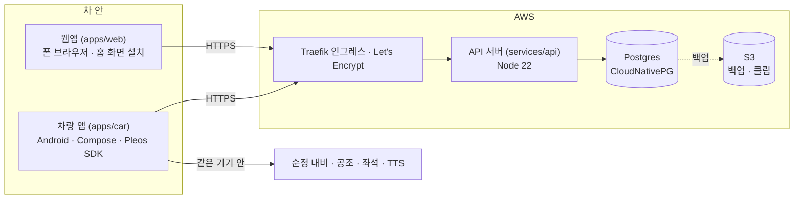

# 구조와 기술 스택

2026-11-12 기준입니다. 기획서 v4(11/11)를 따릅니다. 표의 '상태'는 이 저장소에 실제로 있는 것만 '있음'으로 적었습니다.

## 폴더

```
gachita/
├── apps/
│   ├── web/            웹앱. 폰에서 쓰는 화면
│   └── car/            차량 앱. Pleos 에뮬레이터와 실차에서 도는 Android 앱
├── services/
│   └── api/            API 서버
├── infra/
│   ├── terraform/      AWS 자원
│   └── gitops/         클러스터에 올릴 것의 선언. Argo CD가 읽는다
├── docs/               규칙, 구조, API 명세, 결정 기록, 작업 목록
├── scripts/            규칙 검사, 보드 설정
├── .githooks/          커밋 훅
├── .github/            CI, PR·이슈 양식
└── apk/                공모전 제출용 APK
```

## 한눈에



## 스택

| 묶음 | 스택 | 고른 이유 | 상태 |
|---|---|---|---|
| 웹앱 `apps/web` | HTML · CSS · ES 모듈, 빌드 없음. 설치형 웹앱(PWA: 매니페스트와 서비스 워커). 글꼴 Pretendard | 화면 수가 적고, 차량 웹뷰와 폰 브라우저가 같은 파일을 그대로 읽음. 의존성이 없어 CI가 1초 안에 끝남. 화면이 열 개를 넘거나 상태가 얽히면 Vite + React로 옮김([ADR-0002](adr/0002-stack-split.md)) | 참가 4단계와 여행 화면 있음. 설치와 프로필 화면은 T6 |
| 차량 앱 `apps/car` | Kotlin 2.0 · Jetpack Compose · AGP 8.6 · minSdk 28. Pleos Vehicle 2.3.2, NaviHelper 3.0.5, TextToSpeech 3.3.1 | 내비·공조·좌석·TTS는 Pleos SDK로만 부를 수 있음. 에뮬레이터에서 웹뷰 방식은 메모리 약 253 MB, 네이티브는 약 96 MB였음(Pleos 기준 400 MB) | 없음. T7에서 차박지도 앱의 연동 코드를 옮김 |
| API 서버 `services/api` | Node 22 표준 `http`. Postgres 드라이버 `pg` 하나 | 경로가 열 개 안팎이라 프레임워크 없이 읽힘. 타입이 필요해지면 TypeScript로 옮김 | 있음. Postgres 저장과 기기 프로필 포함 |
| 데이터 | Postgres 17, CloudNativePG로 클러스터 안에서 운영 | 관리형 DB 없이 직접 운영하는 조건. 백업과 복구를 선언으로 다룸 | 선언은 T5 |
| 클라우드 | AWS. EC2 한 대에 K3s 직접 설치. Terraform으로 자원을 만들고 Argo CD가 `infra/gitops`를 읽어 맞춤 | 한 대로 시작해 비용을 낮추고, 클러스터 상태를 저장소에서 읽을 수 있게 함 | 코드는 T4·T5. **아직 아무 자원도 만들지 않음** |
| CI | GitHub Actions. `policy`, `web`, `api` (추가 예정 `car`, `infra`) | SOVA와 같은 필수 검사 구성 | 있음 |

## 사용자 프로필 (OAuth 없음)

- **기기 프로필:** 처음 열면 서버가 프로필 ID와 긴 무작위 토큰을 발급하고, 기기에 저장합니다. 이후 요청은 이 토큰으로 본인임을 보입니다. 서버에는 토큰의 해시만 둡니다.
- **담는 것:** 이름, 자리별 선호(운전석·조수석·뒷자리의 온도·열선·통풍), 기록 동의의 기본값. 기획서 v4 5쪽의 '개인 계정'에 해당합니다.
- **다른 기기로 옮기기:** 한 번만 쓰는 6자 코드로 옮깁니다(T6 이후).
- **하지 않는 것:** 소셜 로그인, 비밀번호, 이메일·전화번호 수집.

## 연산을 두는 곳

Pleos는 주행 중 내비가 아닌 앱의 CPU를 5% 미만, RAM을 400 MB 이하로 두라고 적었습니다. 그래서 차량 앱은 화면과 Pleos SDK 호출, 주행 상태 판단만 맡고, 받아쓰기와 장면 고르기 같은 무거운 연산은 서버에 둡니다. 통신이 끊겨도 이미 받은 부탁의 표시와 차량 제어는 차 안에서 돕니다.

## 외부 API

| 무엇 | 어디서 부르나 | 쓰는 곳 | 상태 |
|---|---|---|---|
| Pleos NaviHelper | 차량 앱 | 경유지 반영, 현재 위치, 장소까지 거리·시간 | 에뮬레이터에서 확인(11/12). 조회와 거리 묻기는 화면 전환 없음 |
| Pleos Vehicle SDK | 차량 앱 | 기어, 좌석별 온도·열선·통풍 | 에뮬레이터에서 일부 확인(11/1, 11/10) |
| Pleos TextToSpeech | 차량 앱 | 제안과 알림을 말로 | 에뮬레이터에서 확인 |
| 길찾기(카카오모빌리티 또는 네이버 클라우드 Directions) | API 서버 | 들르면 늘어나는 시간 계산 | 정하지 않음. `requestTrip`은 장소 한 곳까지만 답해 우회 시간을 주지 못함 |
| 지도 표시(카카오 또는 네이버 지도 SDK) | 웹앱, 차량 앱 | 주행 기억 지도 | 정하지 않음 |
| 음성 받아쓰기·화자 구분 | API 서버 | 대화 기록 | 정하지 않음. 원음을 차 밖으로 보낼지부터 정해야 함 |
| LLM(Claude API) | API 서버 | 장면 고르기 | 정하지 않음 |
| Let's Encrypt | 클러스터 | 인증서 | 선언은 T5 |

## 아직 없는 것

차량 앱, 웹앱의 프로필 화면, 클라우드 자원, 음성과 클립 처리. 순서는 [작업 목록](tasks.md)에 있습니다.
