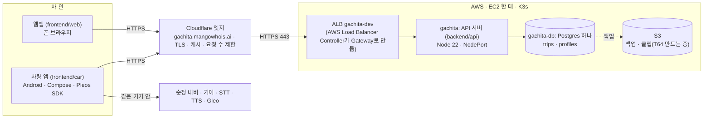

# 구조와 기술 스택

2026-11-14 기준입니다. 참가신청서 문구정리본(11/13)과 11/14 계획 결정을 따릅니다. 달라진 것은 [작업 목록](tasks.md)의 머리말에 있습니다. 표의 '상태'는 이 저장소에 실제로 있는 것만 '있음'으로 적었습니다.

## 폴더

루트에 보이는 폴더는 `docs`, `frontend`, `backend`와 공모전 규정대로 둔 `apk/`입니다.

```
gachita/
├── docs/               규칙, 구조, API 명세, 결정 기록, 작업 목록
├── frontend/
│   ├── web/            웹앱. 폰에서 쓰는 화면
│   └── car/            차량 앱. Pleos 에뮬레이터와 실차에서 도는 Android 앱
├── backend/
│   ├── api/            API 서버
│   └── infra/
│       ├── terraform/  AWS 자원
│       └── gitops/     클러스터에 올릴 것의 선언. Argo CD가 읽는다
├── apk/                제출용 차량 앱 APK
├── .github/            CI, PR·이슈 양식, 규칙 검사와 보드 스크립트(scripts/)
├── .githooks/          커밋 훅
└── Makefile · README.md · AGENTS.md
```

## 한눈에



## 스택

| 묶음 | 스택 | 고른 이유 | 상태 |
|---|---|---|---|
| 웹앱 `frontend/web` | HTML · CSS · ES 모듈, 빌드 없음. 글꼴 Pretendard. 홈 화면 설치(매니페스트와 서비스 워커)는 T6 | 화면 수가 적고, 폰 브라우저가 파일을 그대로 읽음. 의존성이 없어 CI가 1초 안에 끝남. 화면이 열 개를 넘거나 상태가 얽히면 Vite + React로 옮김([ADR-0002](adr/0002-stack-split.md)) | 있음. 프로필, 여행 참가와 여행 화면, 웹 시연(`/demo`). 홈 화면 설치는 만드는 중(T6). 초대 코드 참가와 그룹 초대 수락은 동승 연결 QR(차가 읽음)로 바꾸는 중(T46, 11/14) |
| 차량 앱 `frontend/car` | Kotlin 2.0 · Jetpack Compose · AGP 8.6 · minSdk 29 · targetSdk 34. Pleos Vehicle 2.3.2, NaviHelper 3.0.5, TextToSpeech 3.3.1, SpeechToText 3.3.1 | 내비·기어·TTS·STT는 Pleos SDK로만 부를 수 있음. 에뮬레이터에서 웹뷰 방식은 메모리 약 253 MB, 네이티브는 약 96 MB였음(Pleos 기준 400 MB) | 있음. 여행과 기록 동의, 수음과 받아쓰기, 주행 중 화면, 부탁을 경유지로, 도착 브리핑(에뮬레이터에서 확인, [차량 앱 README](../frontend/car/README.md)). 실차에서는 확인하지 않음 |
| API 서버 `backend/api` | Node 22 표준 `http`. Postgres 드라이버 `pg` 하나 | 경로가 서른 개 안팎이어도 프레임워크 없이 읽힘. 타입이 필요해지면 TypeScript로 옮김 | 있음. 프로필과 구글 연결, 여행, 발화·기록본·피드, 목소리 등록과 대조([API 명세](api/openapi.yaml)). 그룹과 초대 API는 걷어내는 중(11/14) |
| 데이터 | Postgres 17, CloudNativePG로 클러스터 안에서 운영 | 관리형 DB 없이 직접 운영하는 조건. 백업과 복구를 선언으로 다룸 | 실서비스: CloudNativePG 클러스터 하나에 `trips`·`profiles` 두 DB([ADR-0016](adr/0016-slo-capacity-single-postgres.md)). 로컬과 CI는 Postgres 17 컨테이너 |
| 클라우드 | AWS. EC2 한 대에 K3s 직접 설치. Terraform으로 자원을 만들고 Argo CD가 `backend/infra/gitops`를 읽어 맞춤 | 한 대로 시작해 비용을 낮추고, 클러스터 상태를 저장소에서 읽을 수 있게 함 | 11/13부터 실서비스(`https://gachita.mangowhois.ai`). EC2 t4g.large 한 대에 K3s, Cloudflare → ALB → API. 실제 주소 E2E 통과, Route 53이 밖에서 30초마다 점검. 선언은 [backend/infra/terraform](../backend/infra/terraform/README.md), [backend/infra/gitops](../backend/infra/gitops/README.md) |
| CI | GitHub Actions. 네 파트 중 바뀐 것만 검사: `scope`, `policy`, `frontend-spec`, `frontend-app`, `backend-api`, `backend-infra`, `package` | SOVA처럼 필수 검사가 항상 결과를 내고 범위는 그 안에서 고름 | 있음. 11/13부터 자체 러너(Lima VM 다섯, T65)에서 돎 |

## 사용자 프로필

- **기기 프로필:** 처음 열면 서버가 프로필 ID와 긴 무작위 토큰을 발급하고, 기기에 저장합니다. 이후 요청은 이 토큰으로 본인임을 보입니다. 서버에는 토큰의 해시만 둡니다.
- **담는 것:** 이름 또는 별명, 캐릭터나 사진, 기록 동의의 기본값. 좌석·공조 선호는 11/13 계획에서 뺐습니다. 서버에서는 걷어냈고(T68) 웹은 걷어내는 중입니다(T6). 11/14 결정으로 가족은 따로 묶지 않고 같은 차에 탄 기록으로만 잇고, 동승자는 폰의 동승 연결 QR을 차가 읽어 넣기로 했습니다. 지금 코드에는 [ADR-0009](adr/0009-family-group-and-qr-invite.md)의 그룹과 QR 초대(`/j/`)가 남아 있고 걷어내는 중입니다(T46). 사람별 기록은 발화 표와 피드에 쌓입니다(T39, [ADR-0014](adr/0014-transcript-storage.md)).
- **여러 기기:** 기기마다 토큰을 따로 둡니다(`POST /api/profiles/me/tokens`). 다른 기기의 토큰은 그대로입니다.
- **따로 둘 것:** OAuth 로그인으로 만드는 프로필과 현대차 개인 프로필 연동은 기기 프로필과도, 서로와도 다른 기능으로 둡니다. 구글 계정 연결은 서버에 있습니다(T21, [ADR-0006](adr/0006-oauth-provider-google.md)). 한 프로필에 구글 계정 하나이고, 다른 기기에서 계정으로 들어오면 그 기기의 토큰을 새로 줍니다. 웹앱에는 아직 구글 단추가 없습니다. 현대 계정 연동은 조건만 조사했습니다(T22, [ADR-0004](adr/0004-hyundai-profile-link.md)).
- **격리:** 실서비스는 Postgres 클러스터 하나에 프로필(`profiles`)과 여행(`trips`)을 다른 DB로 두고, DB마다 접속 계정을 나눕니다([ADR-0016](adr/0016-slo-capacity-single-postgres.md)). 네트워크는 기본 차단이고 API 파드만 DB에 닿습니다([ADR-0013](adr/0013-network-edge-and-isolation.md)). 처음 선언한 '네임스페이스마다 Postgres 하나'는 ADR-0016으로 바꿨습니다.

## 연산을 두는 곳

Pleos는 주행 중 내비가 아닌 앱의 CPU를 5% 미만, RAM을 400 MB 이하로 두라고 적었습니다. 그래서 차량 앱은 화면과 Pleos SDK 호출, 주행 상태 판단을 맡고, 화자 대조와 장면 고르기 같은 무거운 연산은 서버에 둡니다. 받아쓰기는 Pleos STT(ON_DEVICE)에 맡깁니다([ADR-0008](adr/0008-in-car-capture-and-sdk-stt.md), 차 앱에 있음, T36). 수음 자체는 한 코어의 1% 안팎이었고, STT가 도는 동안의 자원은 아직 재지 않았습니다(T36). 통신이 끊겨도 이미 받은 부탁의 표시와 차량 제어는 차 안에서 돕니다.

## 외부 API

경로와 형식은 [API 명세](api/openapi.yaml)에, 외부 API의 자세한 상태는 [외부 API](api/external.md)에 있습니다.

| 무엇 | 어디서 부르나 | 쓰는 곳 | 상태 |
|---|---|---|---|
| Pleos NaviHelper | 차량 앱 | 경유지 반영, 현재 위치, 장소까지 거리·시간 | 에뮬레이터에서 확인(11/12). 조회와 거리 묻기는 화면 전환 없음 |
| Pleos Vehicle SDK | 차량 앱 | 기어 | 에뮬레이터에서 확인(Cold boot에서만 읽힘). 좌석·공조 적용은 11/13 계획에서 뺌 |
| Pleos TextToSpeech | 차량 앱 | 제안과 알림을 말로 | 에뮬레이터에서 확인 |
| 길찾기(카카오모빌리티 또는 네이버 클라우드 Directions) | API 서버 | 들르면 늘어나는 시간 계산 | 정하지 않음. `requestTrip`은 장소 한 곳까지만 답해 우회 시간을 주지 못함 |
| 지도 표시(카카오 또는 네이버 지도 SDK) | 웹앱, 차량 앱 | 주행 기억 지도 | 정하지 않음 |
| Pleos SpeechToText | 차량 앱 | 대화 받아쓰기(앱이 받은 원음을 `sendAudio()`로 넣음) | 에뮬레이터에서 확인(11/13, [E2E 실측](emulator/e2e-flow.md)). 차 앱에 있음(T36) |
| 화자 대조 | API 서버 | 같은 좌석 구역 안의 사람 구분 | 서버 안의 참조 임베더로 만듦([ADR-0019](adr/0019-speaker-matching.md)). 학습된 모델은 정확도 표 뒤(T38). 말소리는 대조에만 쓰고 버림 |
| LLM(Claude API) | API 서버 | 장면 고르기 | 쓰지 않음. 장면 후보는 규칙으로 고르기로 함(T43 만드는 중, 11/14) |
| Cloudflare | 가장자리 | 주소 `gachita.mangowhois.ai`, 서버로 가는 길, 요청 수 제한 | 동작(11/13부터, [ADR-0010](adr/0010-domain-and-cloudflare-edge.md)). 길·격리·포트는 [ADR-0013](adr/0013-network-edge-and-isolation.md)과 그 1·3절을 대신한 [ADR-0015](adr/0015-split-nodes-private-subnets-alb.md). 클립 영상은 Cloudflare를 지나지 않는 `media` 하위 도메인으로([ADR-0020](adr/0020-media-delivery-subdomain.md), T64 만드는 중) |

## 아직 없는 것

웹앱의 홈 화면 설치, 차량 앱의 발화 올리기·목소리 등록·Gleo와 마이크 주고받기, 녹음 클립과 숏폼 재생. 11/14에 구현 중이고 순서는 [작업 목록](tasks.md)에 있습니다.
