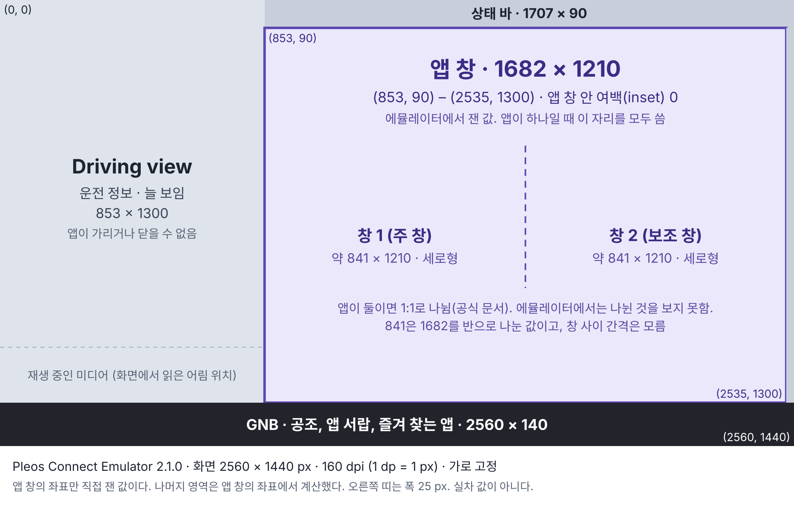

# 에뮬레이터 스펙과 화면 배치

2026-11-13 기준입니다. Pleos Connect Emulator 2.1.0에서 우리가 잰 값과 공식 문서의 화면 규칙을 한곳에 모았습니다. 차량 화면 문서(`frontend/spec/`)와 차량 앱(`frontend/car/`)이 이 문서를 기준으로 씁니다.

**잰 값은 모두 에뮬레이터 값이고 실차 값이 아닙니다.** 값마다 근거를 이렇게 구분합니다.

| 표시 | 뜻 |
|---|---|
| 문서 | Pleos 공식 문서에 적힌 것. 우리가 실행해 보지는 않았을 수 있음 |
| 에뮬 | 에뮬레이터 2.1.0에서 우리가 본 것(Mac mini M5 Pro, 2026-11-01~11-12) |
| 모름 | 찾지 못했거나 재지 않은 것 |

## 한눈에

| 항목 | 값 | 근거 |
|---|---|---|
| 화면 | 2560 × 1440 px, 160 dpi, 가로 고정. 1 dp = 1 px | 에뮬 |
| 우리 앱이 쓰는 자리 | 1682 × 1210 px. 왼쪽 위 (853, 90), 오른쪽 아래 (2535, 1300) | 에뮬 |
| 운영체제 | Android 14 (API 34), arm64-v8a | 에뮬 |
| 앱이 도는 사용자 | Android 사용자 10. `adb` 명령에 `--user 10` | 에뮬 |
| 주행 중 자원 한도 | 내비가 아닌 앱은 CPU 5% 미만, RAM 400 MB 이하 | 문서 |
| 입력 뒤 반응 | 0.25초 안에 반응을 보여 줌 | 문서 |

## 화면 배치



| 영역 | 좌표 (px) | 크기 | 무엇 | 근거 |
|---|---|---|---|---|
| Driving view | (0, 0) – (853, 1300) | 853 × 1300 | 속도, 기어, 주행 가능 거리, 경고등, 차량 그림, 재생 중인 미디어. 늘 보이고 앱이 가리거나 닫을 수 없음 | 문서(역할), 에뮬(위치) |
| 상태 바 | (853, 0) – (2560, 90) | 1707 × 90 | Gleo와 검색, 프로필, 블루투스, 통신 상태, 시계, 알림 | 문서(역할), 에뮬(위치) |
| 앱 창 | (853, 90) – (2535, 1300) | 1682 × 1210 | 우리 앱이 그리는 자리. 앱 창 안의 시스템 여백(inset)은 0 | 에뮬 |
| 오른쪽 띠 | (2535, 90) – (2560, 1300) | 25 × 1210 | 점 세 개짜리 손잡이가 보임. 끌어 봤지만 창이 나뉘지 않음 | 에뮬 |
| GNB | (0, 1300) – (2560, 1440) | 2560 × 140 | 공조(양쪽), 앱 서랍, 즐겨 찾는 앱 | 문서(역할), 에뮬(위치) |

- 직접 잰 것은 앱 창의 좌표뿐입니다(프로브 앱의 창 정보). 다른 영역의 좌표는 앱 창의 좌표에서 계산했고 화면 캡처와 맞춰 봤습니다. 시스템 영역의 정확한 경계는 따로 재지 않았습니다.
- 상태 바, 앱 서랍, 공조 패널, 키보드는 앱 창보다 위에 그려져 쓰는 동안 앱 창을 가릴 수 있습니다(문서).

### 창이 하나일 때와 둘일 때

공식 문서는 앱 창을 window 한 개 또는 두 개로 설명합니다. 화면 문서는 **두 크기를 모두** 다뤄야 합니다.

| 형태 | 쓰는 창 | 크기 | 선언 | 무엇을 두나 | 근거 |
|---|---|---|---|---|---|
| 세로형(portrait) | 1개 | 약 841 × 1210 | `screenOrientation`을 적지 않거나 `portrait` | 핵심 기능과 주요 정보 | 문서(형태), 크기는 계산 |
| 가로형(landscape) | 2개를 합친 1개 | 1682 × 1210 | `screenOrientation="landscape"` | 부가 정보와 확장 기능 | 문서(형태), 에뮬(크기) |

- 841은 1682를 반으로 나눈 값입니다. 창 사이 간격과 창 위의 window bar 높이는 모릅니다.
- **에뮬레이터에서는 앱 창이 하나로만 동작했습니다.** 내비와 우리 앱이 같은 자리를 번갈아 차지했고, 두 앱이 나란히 뜬 것은 보지 못했습니다. 주행 중 내비와 같이타가 나란히 보이는지는 실차에서 확인해야 합니다.

### 창 정책 (Connect-S, 공식 문서)

| 상황 | 동작 |
|---|---|
| 앱이 둘 | 1:1로 나란히 |
| 앱이 하나 | 두 칸을 모두 씀(2:0) |
| 차를 처음 켰을 때 | 주 창에 내비 |
| 새 앱을 열 때 | 지금 보이는 앱의 형태를 따름. 가로형 앱 하나가 떠 있으면 가로형으로, 세로형 둘이 떠 있으면 주 창에 세로형으로 |
| 화면에서 사라진 앱 | 끝나지 않음. 보이던 앱을 닫으면 최근에 쓴 순서로 다시 나옴 |
| 위치 바꾸기 | 세 손가락으로 쓸거나 window bar를 누름 |
| 크기 바꾸기 | window bar를 세 손가락으로 끌거나 창 단추를 누름. 가로형과 세로형이 바뀜 |
| 닫기 | 세 손가락으로 쓸어 닫음. 내비는 닫을 수 없음 |
| 앱에서 다른 앱 열기 | 연 앱이 원래 앱 위에 덮이고, 끝나면 원래 앱으로 돌아옴 |

에뮬레이터에서 본 것:

- 내비가 앞으로 나오면 우리 앱의 창은 화면에서 사라지고 일시정지됩니다. 끝나지는 않습니다.
- 화면 뒤로 간 앱이 얼어(`isFrozen=true`) 알림이 늦게 온 적이 있습니다(11/1). 11/12에는 뒤에 있는 동안에도 경로 알림을 6초 안에 받았습니다.

### 화면 종류 (공식 문서)

| 종류 | 설명 |
|---|---|
| Connect-S | 기본 크기. 17인치, 14.6인치, 12.9인치 |
| Connect-W | 더 넓은 화면. 차량 상태에 따라 높이가 늘어나는 것은 Connect-W-Extended |
| Connect-WF | 해상도가 낮은 화면 |

에뮬레이터의 기본 화면(2560 × 1440)이 어느 크기에 해당하는지는 문서에서 찾지 못했습니다(모름).

## 화면을 설계할 때 지킬 것 (공식 문서)

| 항목 | 기준 |
|---|---|
| 글자 크기 | 12sp 이상 권장. 글자의 실제 높이는 18 px 이상을 권장 |
| 서체 | 시스템 화면은 Asta Sans(한국어, 영어). 개성이 강한 서체는 피함 |
| 한눈에 | 운전자가 1~2초 안에 알아볼 수 있게 핵심만 보여 줌 |
| 조작 | 한 손으로, 단순한 조작만. 두 손을 쓰게 하지 않음 |
| 주행 중 | 동영상, 움직이는 이미지, 글자 자동 스크롤로 시선을 끌지 않음 |
| 반응 | 입력 뒤 0.25초 안에 반응. 더 걸리면 처리 중임을 보여 줌. 앱 실행과 콘텐츠 로드는 10초 안, 단추 반응은 2초 안 |
| 누름 효과 | 누르면 95%로 줄고 배경색이 바뀜. 손가락이 영역을 벗어나면 취소 |
| 통신 | 주행 중 통신이 끊기거나 느려져도 핵심 기능이 돌아가게 함 |

주행 중 화면 제한에 대해 에뮬레이터에서 본 것:

- 기어 D에서 UX 제한 값은 80이었습니다(설정 금지와 동영상 금지를 합친 값).
- 주행 중 쓰는 화면으로 선언한(`distractionOptimized`) 화면은 기어 D, 80 km/h에서 차단 화면 없이 떴습니다. 심사 기준과 같다는 뜻은 아닙니다.

## 에뮬레이터 사양

| 항목 | 값 | 근거 |
|---|---|---|
| 버전 | Pleos Connect Emulator 2.1.0 (2026-10-19 배포) | 문서 |
| 시스템 이미지 | Pleos Connect v2.1.0 APIs arm64, API 34 | 에뮬 |
| 기기 정의 | `Pleos_Connect_v2_0`: 2560 × 1440, mdpi, 가로, RAM 4 GiB | 에뮬 |
| Android | 14 (SDK 34), `arm64-v8a`, 빌드 종류 `user` | 에뮬 |
| 그래픽 | OpenGL ES 3.0, Vulkan 1.3 | 에뮬 |
| AVD 설정 | RAM 4096 MB, CPU 4코어, 데이터 8 GB, `hw.gpu.mode=host` | 에뮬 |
| 앱 힙 한도 | 192 MB | 에뮬 |
| 기본 언어 | 한국어. 차량 설정 > 일반 설정 > 언어에서 바꿈 | 문서 |
| 기본 위치 | 판교 | 에뮬 |
| 부팅 | Cold boot여야 함. Quick boot로는 차량 값(VHAL)을 쓸 수 없음 | 문서 |
| 블루투스 동글 | 지원하지 않음 | 문서 |
| 권장 그래픽 카드 | 외장 GPU 8 GB급(RTX 4060 Laptop 이상). 최소 6 GB급 | 문서 |

우리 장비와 실행 명령:

- Mac mini M5 Pro(메모리 64 GB), Android Emulator 37.2.13, AVD 이름 `Pleos_Connect_2_1`.

```sh
$HOME/Library/Android/sdk/emulator/emulator -avd Pleos_Connect_2_1 -no-snapshot -gpu host -no-metrics -crash-report-mode never -port 5554
```

- 음성을 가상 마이크에 넣을 때는 `-grpc 8556 -grpc-use-token -audio none`을 더합니다. 이 Mac에는 마이크 입력 장치가 없어, 기본 오디오 설정으로 음성을 넣으면 에뮬레이터가 종료됐습니다.
- 실차의 칩과 메모리 사양은 공식 문서에서 찾지 못했습니다(모름).

## 도구

| 도구 | 쓰는 법 | 알아 둘 것 | 근거 |
|---|---|---|---|
| Virtual Console | `adb forward tcp:8088 tcp:8088` 뒤 `http://127.0.0.1:8088/` | 기어, 속도, 방향지시등, 배터리 같은 차량 값을 바꿈. 콘솔 세션이 꺼져 있으면 설정 호출이 성공으로 답해도 값이 바뀌지 않았음. 설정한 뒤 다시 읽어 확인함 | 문서, 에뮬 |
| 폼 팩터 시험 | 에뮬레이터의 FormFactorConsole 앱과 호스트의 Host Display Bridge(Go 1.22 이상, 포트 8095·8096). 가상 화면을 만들어 12.9인치·14.6인치 등과 가로·세로를 바꿔 봄 | 에뮬레이터를 별도 창으로 띄워야 함. **우리는 아직 써 보지 않았음** | 문서 |
| 마이크 | 에뮬레이터의 Extended Controls > Microphone에서 입력을 켬 | 우리는 gRPC로 음성 파일을 넣었음. 넣기 시작할 때 에뮬레이터가 세 번 멈춘 기록이 있음(11/2) | 문서, 에뮬 |

## 에뮬레이터에서 되는 것과 안 되는 것

| 기능 | 본 것 | 걸리는 점 |
|---|---|---|
| 차량 값 읽기 | Virtual Console에서 바꾼 값이 구독 알림으로 옴 | 지원하지 않는 속성은 오류로 옴(연료, 통행료 단말). 값의 단위와 범위가 콘솔과 다름(창문 40 → 4, 속도는 m/s) |
| 공조·시트 설정 | 지원 여부 조회 → 설정 → 다시 읽기로 반영을 확인 | 지원 영역이 함수마다 다름. 지원 조회가 돌려준 영역만 씀 |
| 내비 정보 읽기 | 목적지, 경유지, 안내 상태, 다음 회전, 현재 위치, 장소까지 거리·시간. 화면이 넘어가지 않고 0.1~0.2초 | 경유지 좌표가 0.0으로 옴. 제한 속도는 0만 옴 |
| 내비에 요청 | 경로 요청은 5.9초, 경유지 추가는 6.0초 뒤 알림. 내비가 앞으로 나옴 | 경유지를 더하면 기존 안내가 끊겼다 다시 시작. 안내 취소는 다섯 번 불러도 끝나지 않은 적이 있음(11/12) |
| 내비 지도 | 경로와 안내는 나옴 | 지도 배경이 비어 있음 |
| 우리 앱의 TTS | 여섯 문장을 끝까지 읽음. 첫 소리까지 0.29~0.44초 | 영어 상호 발음이 어색함 |
| 우리 앱의 STT | 가상 마이크로 넣은 말을 받아 적음. 준비까지 0.2~0.7초 | 우리 STT가 듣는 동안 Gleo 호출이 무시됨 |
| Gleo | 앱이 등록한 기능을 읽고 우리 화면을 엶 | Gleo의 목소리는 소리로 나오지 않음. Gleo의 차량 제어는 실패함 |
| 위치 | 에뮬레이터 GPS를 옮기면 따라옴. 영역 진입·이탈 알림이 옴 | |
| 통신 끊김 시험 | 요청마다 오류로 끝나는 것을 봄 | 끊은 뒤 통신이 돌아오지 않아 Cold boot가 필요했음. 시험의 마지막에만 돌림 |
| 메모리 | 웹 화면을 띄우는 앱 약 253 MB, 네이티브 앱 약 96 MB, 순정 내비 약 292 MB | CPU 사용률은 Mac 성능에 따라 달라 재지 않음 |
| 차량 마이크 원음 녹음 | 확인 중 | [T10](https://github.com/team-pitcrew/gachita/issues/12) |

## 실차에서 확인해야 하는 것

- 내비와 같이타가 나란히 뜨는지, 그때 각 창의 실제 크기
- 주행 중 화면 제한이 실제로 어떻게 걸리는지
- 차량 값의 지원 범위와 단위, 응답 시간
- 실제 목소리와 차 안 소음에서의 음성 인식, Gleo의 목소리
- CPU와 메모리 사용량

## 근거

공식 문서(2026-11-01~11-13 확인):

- [화면 구성과 화면 종류](https://document.pleos.ai/docs/connect/guide/docs-design/getting-started/layout)
- [창 정책](https://document.pleos.ai/docs/connect/guide/docs-design/getting-started/window)
- [앱 구조와 화면 모델](https://document.pleos.ai/docs/pleos-only/vehicle-app-planning-guide/app-structure-screen-model)
- [디자인 원칙](https://document.pleos.ai/docs/connect/guide/docs-design/Introduction/designing-apps-for-driving), [글자](https://document.pleos.ai/docs/connect/guide/docs-design/foundations/typography), [누름 효과와 창 조작](https://document.pleos.ai/docs/connect/guide/docs-design/foundations/interaction)
- [성능과 자원](https://document.pleos.ai/docs/pleos-only/vehicle-app-planning-guide/performance-resource-mgmt), [심사: 기능과 성능](https://document.pleos.ai/docs/pleos-only/distribute/app-review-guide/review-functionality-performance-stability)
- [에뮬레이터 설정](https://document.pleos.ai/docs/connect/guide/getting-started/application-development/configure-pleos-connect-emulator), [에뮬레이터 배포 기록](https://document.pleos.ai/docs/pleos-only/release-note/emulator-release-note)
- [Virtual Console](https://document.pleos.ai/docs/pleos-only/app-test-guide/virtual-console-guide), [폼 팩터 시험](https://document.pleos.ai/docs/pleos-only/app-test-guide/form-factor-test-guide)

우리가 잰 기록은 저장소 밖(지환의 작업 폴더)에 있습니다. 화면 캡처와 로그가 필요하면 지환에게 요청합니다.

| 날짜 | 무엇을 쟀나 |
|---|---|
| 11/1 | 새 장비에 설치하고 첫 부팅, 기기 정의와 AVD 설정 |
| 11/1 | Pleos 기능 47개를 프로브 앱으로 호출. 앱 창 크기, 주행 중 제한 값, 화면 뒤 앱의 동결 |
| 11/2 | 그래픽 API, TTS 시간, Gleo 응답, 앱 안 음성 |
| 11/10 | 차량 앱 설치와 실행, 앱 창 1682 × 1210, 메모리 |
| 11/12 | 내비 호출마다 화면이 넘어가는지, 창 나누기 시도 |
