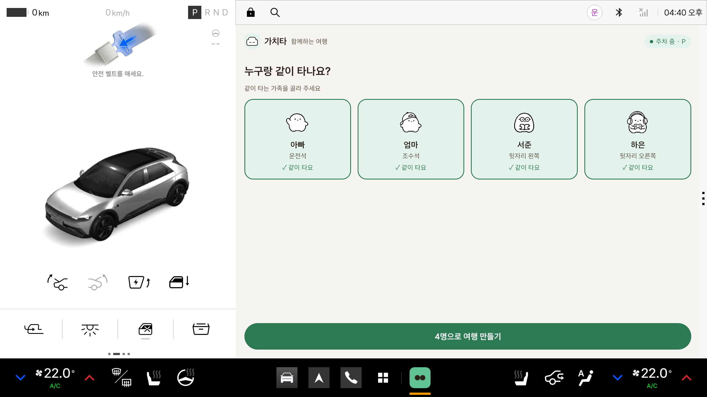
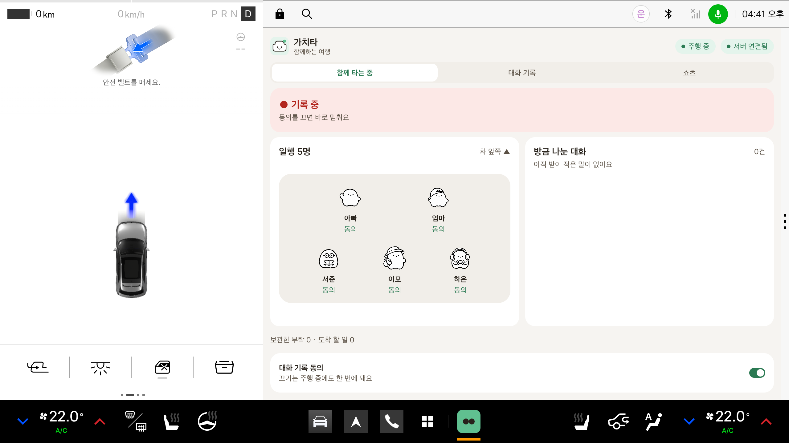
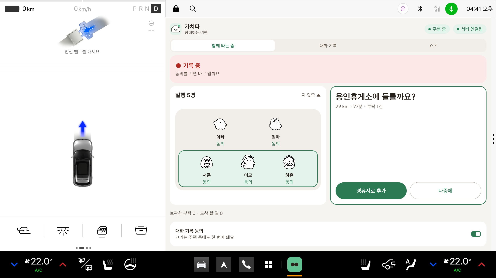
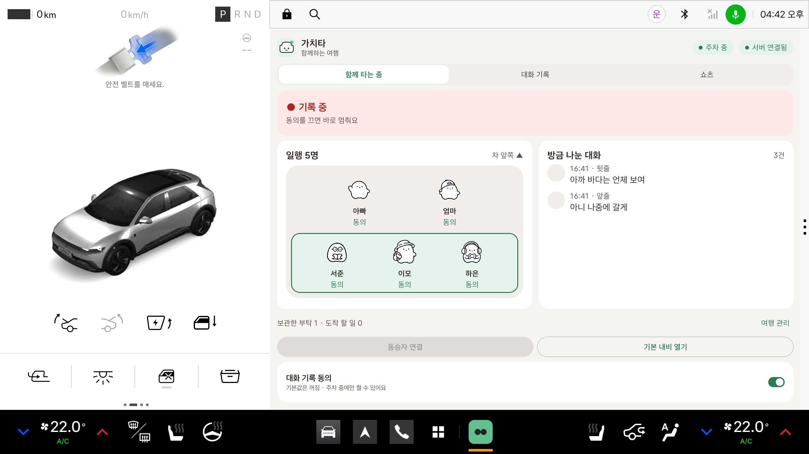
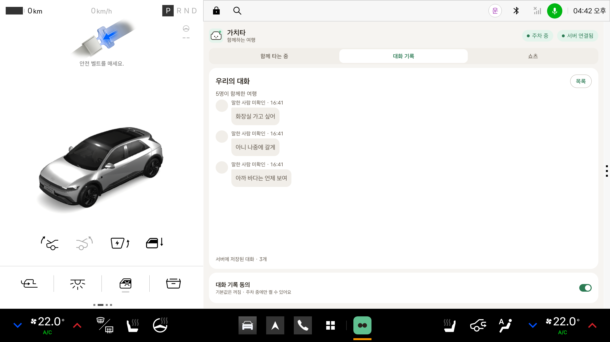
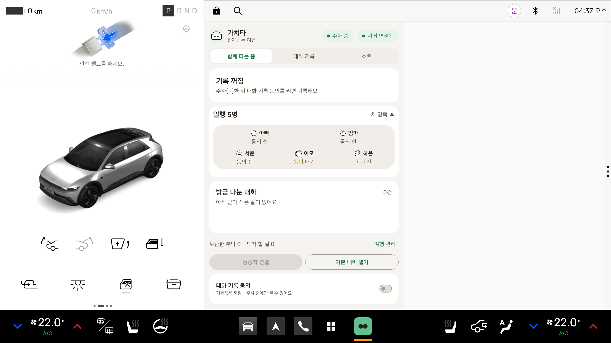
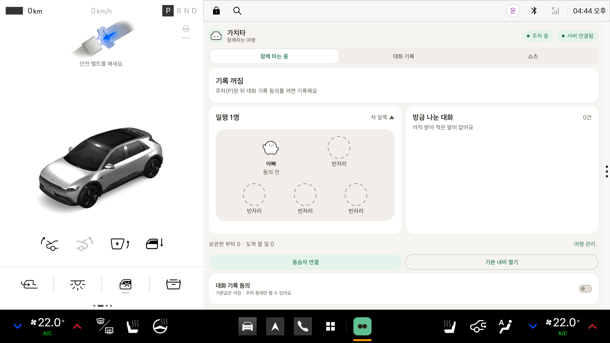

# T83 차량 화면 인수 검증

2026년 11월 14일 독립 Pleos AVD에서 최신 차량 화면과 동의 흐름을 확인했습니다. 실제 휴대폰과 실차는 시험하지 않았습니다. 기존 AVD와 서비스 데이터는 보존하고 별도 로컬 API·DB를 사용했습니다.

## 변경과 기준

PR #239가 인수한 헤더·탭·본문·동의 구조를 기준으로 합니다. T20 시안은 [Figma](https://www.figma.com/design/bkASxUWEfhJKjawI1sVK8n)와 `frontend/spec/car.md`에서 이어집니다. 이번 변경은 차량이 제공한 좌석 목록을 QR 자리 선택에도 적용합니다. 좁은 창에서 이름과 동의 상태가 잘리던 문제를 고칩니다. 내비 열기 결과가 기록 상태 문구를 계속 가리던 문제도 고칩니다.

## 결과

- Android `assembleDebug testDebugUnitTest`: 단위 검사 106개를 통과했습니다.
- `make -o db check`: 웹 29개와 API 43개를 통과했습니다. 이후 다른 PR에서 추가한 API 검사는 이 브랜치 기준 수치에 포함하지 않습니다.
- 기본 `e2e.py`: 20개 조건을 통과했습니다. 주행 중 동의 켜기 차단, 폰 참가자의 본인 동의, 연결 끊김 중 즉시 중지, 재실행 뒤 중지 유지, 재연결 후 서버 반영을 포함합니다.
- 좁은 841dp 창의 별도 검사에서는 다섯 이름과 네 개의 ‘동의 전’, 폰 참가자의 ‘동의 대기’를 모두 확인했습니다. 이 조건을 `e2e.py`에도 추가했습니다.
- `ui_acceptance_e2e.py`: macOS Yuna 합성 음성 3문장을 입력했습니다. 부탁 제안 → ‘나중에’ 보관 → 주차 → 서버 대화 3개 전체 열기를 확인했습니다. 호스트 마이크는 껐습니다. 전사 오차 ‘아빠’ → ‘아까’는 원문 그대로 보존했습니다. 실차 전사 정확도와 화자 식별 성공을 뜻하지 않습니다.
- Virtual Console의 조수석 점유를 바꾸자 빈자리가 ‘앉아 있어요’로 바뀌고, 해제하면 빈자리로 돌아왔습니다. 시험 후 원래 값을 복원했습니다. SDK 좌석 목록과 빈자리 선택은 2석·미지원 3열·빈 목록 대체값도 단위 검사합니다.

디버그 APK SHA-256: `9d66df7d72e73f2177a37cd4537625646d8633ef73a3f33677e271585b7aa7f1`.

기본 E2E 후 좌석 배치를 보완한 APK에서 좁은 창과 음성 흐름·점유 변경을 다시 확인했습니다. 모든 검사를 한 번의 실행으로 수행했다고 표현하지 않습니다. [조건별 결과](checks.json)는 토큰과 원음을 포함하지 않습니다.

## 화면

| 여행 만들기 | 주행 |
|---|---|
|  |  |

| 부탁 제안 | 주차 |
|---|---|
|  |  |

| 전체 대화 | 좁은 창의 동의 상태 |
|---|---|
|  |  |

| 점유 있음 | 점유 해제 |
|---|---|
|  |  |

에뮬레이터의 시스템 시각은 호스트 시각과 다릅니다. 이 시각을 실제 여행 시각으로 사용하지 않습니다. 제안은 실제 차량 앱이 생성했고, 음성은 합성 입력입니다.
