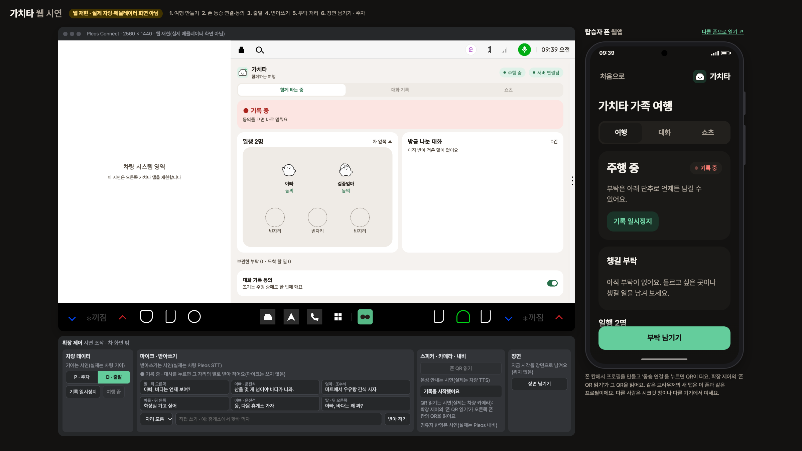
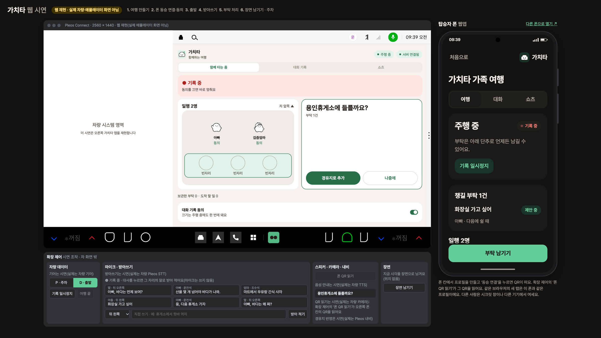
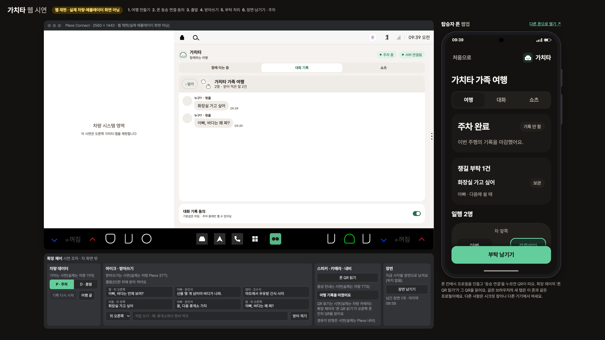
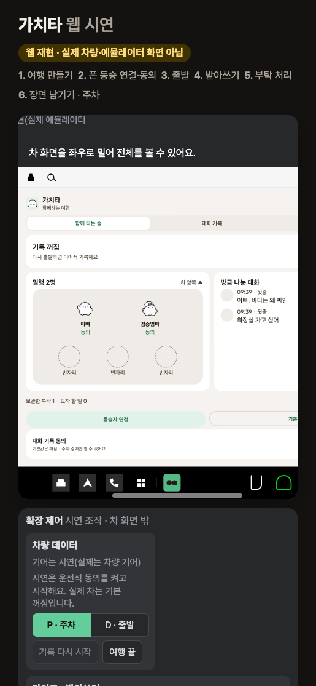

# T82 웹 재현 검증

2026년 11월 14일 별도 로컬 API와 PostgreSQL에서 시연 흐름을 확인했습니다. 이 그림은 브라우저에서 실제 실행한 웹 재현입니다. 실제 차량과 에뮬레이터 화면은 아닙니다.

기준 차량 화면은 T83의 고정 헤더·탭·본문·동의 구조입니다. 차량 앱의 `MainActivity.kt`와 `Theme.kt`, 같은 날 별도 Pleos AVD의 주행·제안·주차 캡처를 대조했습니다. T20 원안에서 발전한 대화 기록·쇼츠 탭을 반영했습니다. 운전석 한 명과 폰으로 참가한 한 명을 사용하며, 기존 시연의 운전석 동의 방식은 유지합니다. 실제 차량은 기록 동의가 꺼진 상태로 시작합니다.

| 확인 | 결과 |
|---|---|
| 여행 생성 → 폰 프로필 → 일회용 QR → 조수석 연결 | 통과했습니다. QR 읽기는 같은 출처 iframe의 값을 읽는 시연입니다. |
| 폰 동의 → D 출발 → 두 문장 → 부탁 제안·나중에 보관 | 통과했습니다. 대사는 마이크 대신 시연 단추로 입력했습니다. |
| 장면 저장 → P 주차 → 대화 기록 전체 보기 | 대화 2건, 보관한 부탁 1건, 장면 1개를 확인했습니다. |
| 폰 동의 철회 | 차 재현에서도 이전 자막을 비웠습니다. |
| 넓은 화면 | CSS 1920×1080에서 차와 실제 웹앱 iframe을 함께 확인했습니다. |
| 좁은 화면 | CSS 412×892에서 최소 배율 0.3과 차 영역의 가로 스크롤을 확인했습니다. 문서 전체 너비는 412px입니다. |
| 자동 검사 | 웹 단위 검사 29개, API 51개, 격리 이미지 E2E 12단계를 통과했습니다. |

차량 시스템의 속도·주행 가능 거리·가상 기어 패널은 제거했습니다. 값이 없는 시스템 영역은 생략 표시로 남깁니다. Pleos 상태 표시줄과 하단 독은 CSS로 재현했습니다. 시연 입력은 차 화면 밖 확장 제어에 있습니다. 실제 폰의 설치·모바일 데이터·카메라 확인은 하지 않았습니다.

| 주행 | 부탁 제안 |
|---|---|
|  |  |

| 대화 기록 | 최소 배율 |
|---|---|
|  |  |
